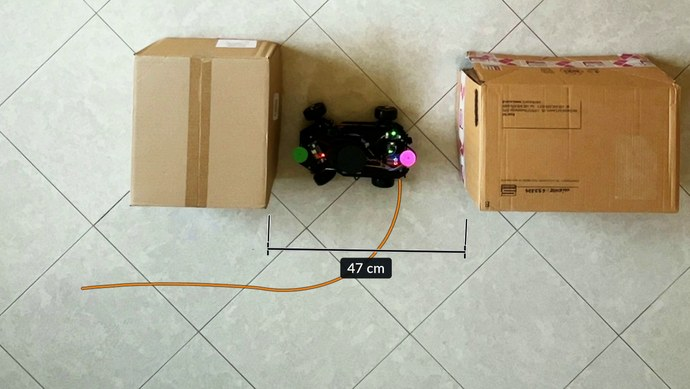

## Pietro Gelmini

Robotics student at the University of Trento · Trento, Italy\
[LinkedIn](https://www.linkedin.com/in/pietro-gelmini) · [gelmini.pietro@gmail.com](mailto:gelmini.pietro@gmail.com)

Control, state estimation and embedded systems on real hardware. Now building a 3D-printed SO-101 arm for robot learning.

#### Projects

**[Autonomous drift parking](https://github.com/Gelminaio/drift-mpc-ackermann)** · 1:10 car · Apr–Oct 2026\
The car finds a parking gap with its lidar and slides into it sideways. Nonlinear MPC (acados) at 50 Hz on a Raspberry Pi 4,
a dynamic model with saturating tires identified from video, IMU and encoders, ESP32 + micro-ROS for motors and sensors,
and the same ROS 2 stack in Gazebo.\
47 cm gap for a 26 cm car · ten clean takes of the full routine · 52 unit tests in CI\
[Video](https://github.com/Gelminaio/drift-mpc-ackermann/releases/tag/phase-12) · [Technical report (PDF)](https://github.com/Gelminaio/drift-mpc-ackermann/blob/main/report/report.pdf)

 

**[OS blockchain simulation](https://github.com/Gelminaio/os-blockchain-project)** · team of 3 · Apr–Sep 2026\
Nodes, miners and clients run as separate processes that share no memory: FIFOs for data, POSIX signals for control,
simulated proof-of-work, Merkle trees and SHA-256 written from scratch. Operating Systems course, graded 10/10.

#### In progress

- **SO-101 brick builder**: a 3D-printed SO-101 arm that sorts toy bricks seen by a webcam and assembles them from a
  blueprint, with inverse kinematics and imitation learning (LeRobot).
- **Pick-and-place with a UR5**: Fundamentals of Robotics course project. Block detection and pose estimation, inverse
  kinematics and trajectories in simulation, then the same pipeline on the SO-101.

#### Open source

Small fixes merged in ros2/rclcpp ([#3145](https://github.com/ros2/rclcpp/pull/3145), [#3146](https://github.com/ros2/rclcpp/pull/3146))
and ros2/rosbag2_bag_v2 ([#52](https://github.com/ros2/rosbag2_bag_v2/pull/52)).

#### Education and experience

- **University of Trento**, BSc in Computer, Communications and Electronic Engineering · 2024–2027
- **Metalsistem S.p.A.**, Rovereto: 3D software developer intern, interactive 3D interface for industrial environments (Babylon.js) · 2023
- **ITT G. Marconi**, Rovereto: diploma in Computer Science, Big Data track, 100/100 · 2019–2024

#### Stack

C++ · Python · C · ROS 2 · acados · CasADi · Gazebo · ESP32 · micro-ROS · Raspberry Pi · PlatformIO · Docker · GitHub Actions · LaTeX
