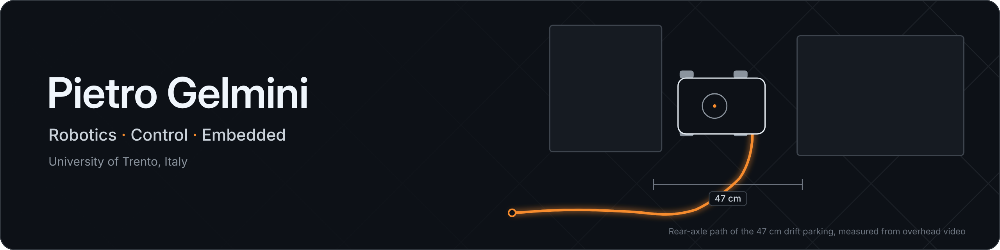

  
  
  

Robotics student at the University of Trento, BSc in Computer, Communications and Electronic Engineering (2027).
Interested in control, state estimation and robot learning, on real hardware.

### Featured

<table>
  <tr>
    <td width="55%">
      
    </td>
    <td>
      <h4><a href="https://github.com/Gelminaio/drift-mpc-ackermann">Autonomous drift parking</a></h4>
      A 1:10 car finds a parking gap with its lidar and slides into it sideways.
      <ul>
        <li><b>47 cm</b> gap for a 26 cm car</li>
        <li>Nonlinear MPC (acados) at <b>50 Hz</b> on a Raspberry Pi 4</li>
        <li>Tire model identified from video, IMU and encoders</li>
        <li><b>Ten clean takes</b> of the full routine: slalom, donut, drift parking</li>
        <li><b>52</b> unit tests in CI</li>
      </ul>
      C++ · Python · ROS 2 Jazzy · ESP32 + micro-ROS · Gazebo
    </td>
  </tr>
</table>

**[os-blockchain-project](https://github.com/Gelminaio/os-blockchain-project)**: a multi-process blockchain in C. Nodes, miners and clients
share no memory and talk over FIFOs and POSIX signals; SHA-256 written from scratch. Operating Systems course, graded 10/10.

### Now

Building an **SO-101** arm, 3D-printed and driven with LeRobot, that sorts toy bricks and assembles them from a blueprint:
vision, inverse kinematics, imitation learning.

### Toolbox

<picture>
  <source media="(prefers-color-scheme: dark)" srcset="https://skillicons.dev/icons?i=cpp,c,py,ros,linux,raspberrypi,arduino,cmake,docker,git,githubactions,latex&theme=dark"/>
  
</picture>

and acados · CasADi · Gazebo · micro-ROS · PlatformIO
